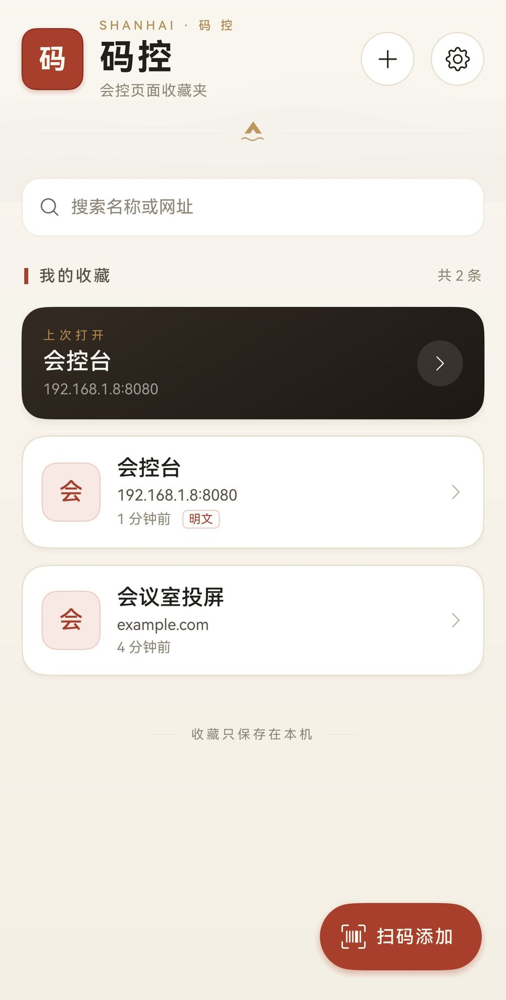
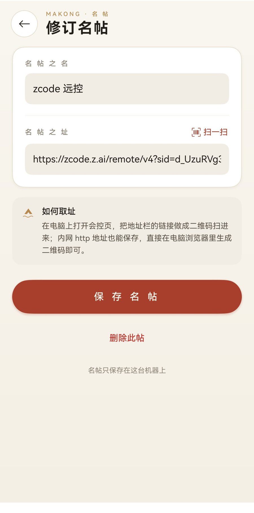

# shanhai-makong

[](LICENSE)
[](https://github.com/cn-zhangpeng/shanhai-makong/actions/workflows/mirror.yml)

「码控」：山海系列 · 鸿蒙版会控页面收藏夹。

扫一扫会控页面上的二维码，把地址存成本地名帖，点开直接用内嵌 WebView 打开——不用每次手输网址。

## 仓库内容

| 目录 | 说明 |
| --- | --- |
| [`makong-harmony/`](makong-harmony/README.md) | HarmonyOS 客户端（Stage 模型 + ArkTS + ArkUI），当前唯一实现 |

## 功能一览

- **扫码入卷**：Scan Kit 默认扫码界面，扫码结果直接回填网址（系统界面已预授权相机，App 无需申请相机权限）
- **名帖管理**：新增 / 修订 / 删除 / 搜索，本地 Preferences 持久化，只存在这台机器上
- **续卷**：一键回到上次访问的页面，可开启「启动时进入上次名帖」
- **内嵌打开**：ArkWeb 加载任意 http/https 地址，保留网页登录态
- **网页导航**：返回键优先回退网页历史；顶栏支持刷新、复制链接、在浏览器打开
- **加载兜底**：错误页给出错误码与提示，可重试或改用系统浏览器
- **摄像头 / 麦克风**：网页申请时自动授予，兼容会控页 WebRTC 场景

## 界面

山海系列新中式设计：宣纸暖白 × 墨色 × 朱砂、鎏金点缀。三页结构：名帖列表 → 新添 / 修订名帖 → 内嵌网页。

<table>
  <tr>
    <td align="center" width="33%">
      <br />
      <sub>名帖列表</sub>
    </td>
    <td align="center" width="33%">
      <br />
      <sub>内嵌网页</sub>
    </td>
    <td align="center" width="33%">
      <br />
      <sub>修订名帖</sub>
    </td>
  </tr>
</table>

更多效果图（空态、设置、确认框、错误兜底、长按菜单）见 [`makong-harmony/README.md`](makong-harmony/README.md#效果图)。

设计说明、构建/安装步骤同样在该 README 中。

## 快速开始

1. 用 DevEco Studio（26.x 验证）打开 `makong-harmony` 目录；
2. 在 `File > Project Structure > Signing Configs` 里生成自动签名；
3. 连接真机运行，或用 hvigor 命令行构建：

```powershell
$env:DEVECO_SDK_HOME = "D:\Sofwares\Huawei\DevEco Studio\sdk"
$env:JAVA_HOME = "D:\Sofwares\Huawei\DevEco Studio\jbr"
& "D:\Sofwares\Huawei\DevEco Studio\tools\node\node.exe" `
  "D:\Sofwares\Huawei\DevEco Studio\tools\hvigor\bin\hvigorw.js" `
  --mode module -p product=default -p buildMode=debug assembleHap --no-daemon
```

## 说明

- 构建产物、签名证书、本机 IDE 配置、截图目录均已在 `.gitignore` 中排除。
- 仓库中 `makong-harmony/build-profile.json5` 的签名配置已清空；在 DevEco 中生成自动签名后会写入本机证书路径，提交前请确认没有把本机签名信息带进仓库。

## Gitee 镜像

GitHub 为主仓库，Gitee 只做只读镜像：<https://gitee.com/cn-zhangpeng/shanhai-makong>

同步由 [`.github/workflows/mirror.yml`](.github/workflows/mirror.yml) 负责，触发时机：

- 每次 push 到 `main`；
- 每天 02:00（北京时间，即 UTC 18:00）定时同步一次；
- 也可以在 Actions 页面手动 `Run workflow`。

首次启用前，需要在 GitHub 仓库的 `Settings > Secrets and variables > Actions` 里配置三个 Secret：

| Secret | 说明 |
| --- | --- |
| `GITEE_USERNAME` | Gitee 用户名（`cn-zhangpeng`） |
| `GITEE_TOKEN` | Gitee 私人令牌，勾选 `projects` 权限即可 |
| `GITEE_REPO` | Gitee 仓库路径（`cn-zhangpeng/shanhai-makong`） |

工作流使用 [`wearerequired/git-mirror-action`](https://github.com/wearerequired/git-mirror-action)，会把 GitHub 的提交、分支和标签整体镜像到 Gitee。Gitee 侧的仓库需要提前建好（空仓库即可），不要在 Gitee 上直接改代码，否则下次同步会被覆盖。

## 许可证

本项目基于 [MIT License](LICENSE) 开源，Copyright (c) 2026 山海紫穹。

