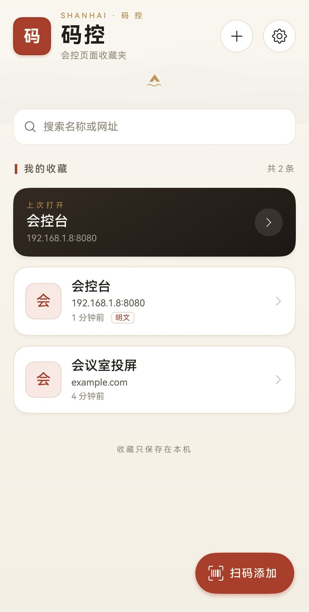
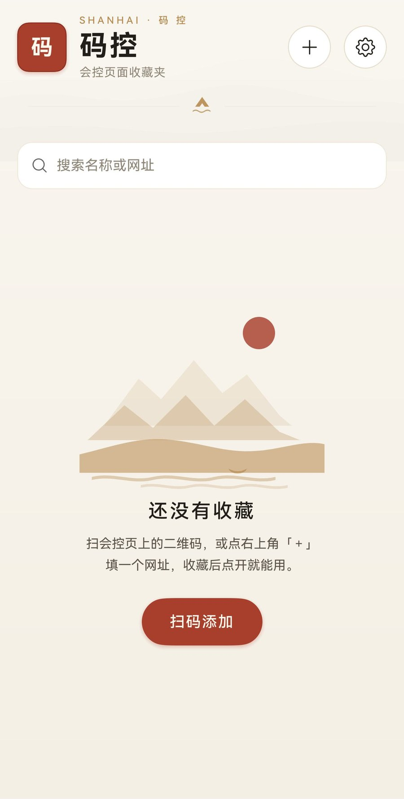
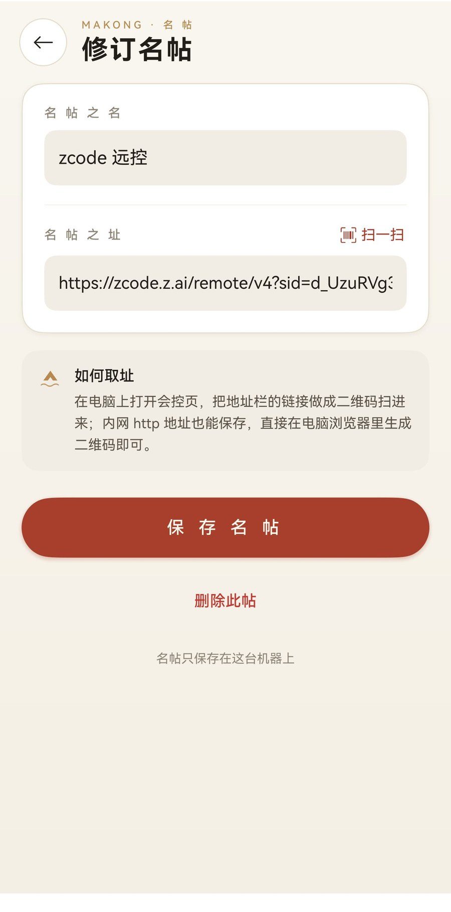
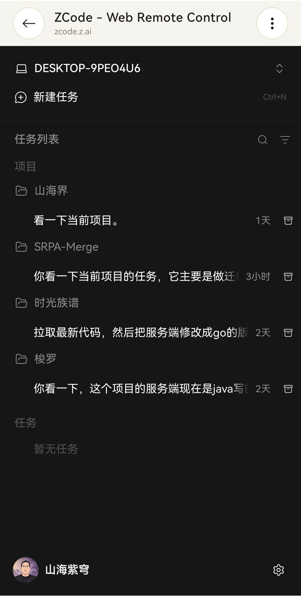
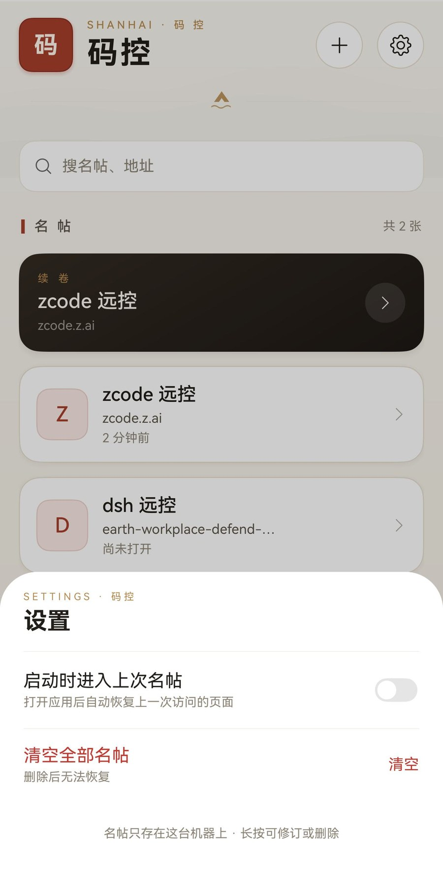
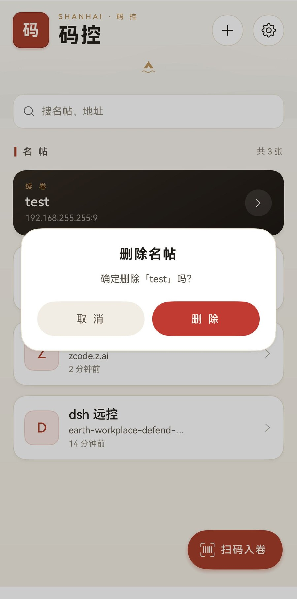
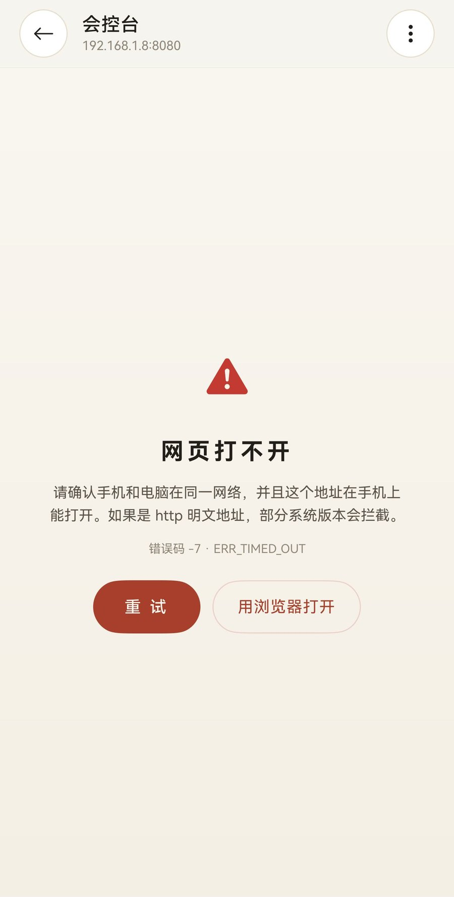
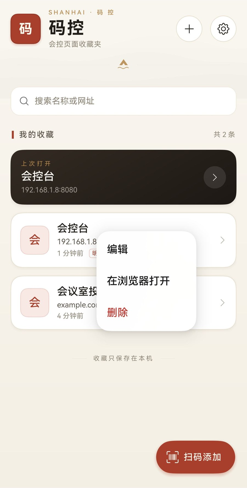

# 码控 · makong-harmony

鸿蒙版「会控页面收藏夹」：扫一扫页面上的二维码，把会控地址存成本机会话，点开直接用内嵌 WebView 打开，不需要每次手输网址。

- 技术栈：HarmonyOS Stage 模型 + ArkTS + ArkUI，无后端、无三方库。
- 最低兼容版本：HarmonyOS 5.0.0(12)（`compatibleSdkVersion` / `targetSdkVersion` 均为 `5.0.0(12)`，可用 API 26 SDK 编译）。
- 应用包名：`com.shanhai.makong`。

## 界面设计

整体沿用「山海系列」的新中式语言：**宣纸暖白 × 墨色 × 朱砂，鎏金作点缀**，不追通用工具风。

| 元素 | 处理 |
| --- | --- |
| 底色 | 宣纸渐变 `#F9F6F0 → #F4EFE4`，页头压一层极淡墨色山脊 |
| 品牌 | 朱砂圆角方印「码」+ 鎏金小字 `SHANHAI · 码控`，山纹徽记作分隔 |
| 主色 | 朱砂 `#A83E2C` 只给主操作（扫码入卷、保存名帖、续卷卡），其余保持克制 |
| 名帖卡 | 白纸卡 + 1px 发丝边 + 大圆角 + 姓名印（首字），名称 / 域名 / 时间三阶墨色 |
| 名帖列表 | 朱砂竖线小标题「名 帖」，底部一行「山海有信 · 名帖在此」收尾 |
| 空态 | 鎏金群山 + 朱砂日轮插画，配「尚未收卷」与两句引导 |
| 续卷卡 | 墨色渐变卡 + 鎏金小字「续 卷」，与白纸卡形成层次 |
| 确认框 | 自绘纸面 `ConfirmDialog`（圆角 24、纸色底、朱砂主按钮），不用系统 AlertDialog |
| 图标 | 应用图标为宣纸底 + 朱砂方印「码」；界面图标统一实心 SVG，`fillColor` 运行时染色，自动适配深色模式 |

三页结构不变：名帖列表（Index）→ 新添 / 修订（EditPage）→ 内嵌网页（WebViewPage）。

## 功能

| 能力 | 说明 |
| --- | --- |
| 扫码添加 | 调起 Scan Kit 默认扫码界面，识别二维码后自动填网址；系统界面已预授权相机，**无需申请相机权限**。支持从相册选图识别 |
| 手动添加 / 编辑 | 名称 + 网址两个输入框；编辑态里可以再次扫码覆盖网址，也可以删除会话 |
| 会话列表 | 按最近打开时间倒序；卡片显示名称、域名、最近打开时间、HTTP 标记；支持搜索（名称 / 地址）；长按卡片可编辑、在浏览器打开、删除 |
| 继续上次 | 首页顶部「继续上次」横幅一键回到上次的页面；设置里可开启「启动时进入上次会话」 |
| 内嵌打开 | WebView 打开任意 http/https 地址，开启 JavaScript、DOM Storage、数据库、混合内容，保证会控页的登录态可用 |
| 网页导航 | 系统返回键优先回退网页历史，退无可退才回列表；顶栏菜单支持刷新、复制链接、在浏览器打开 |
| 加载失败兜底 | 出错时给出错误码与提示（`-10` 会单独说明可能是明文 http 被系统拦截），可重试或改用系统浏览器打开 |
| 摄像头 / 麦克风 | 网页申请权限时自动授予可访问的资源，兼容会控页里的 WebRTC 场景 |

## 目录结构

```
makong-harmony/
├── AppScope/
│   ├── app.json5                     # 应用信息（bundleName / 版本 / 图标 / 名称）
│   └── resources/base/               # 应用级图标与字符串
├── entry/src/main/
│   ├── module.json5                  # 模块、权限、Ability 声明
│   ├── ets/
│   │   ├── common/
│   │   │   ├── AppContext.ets        # 保存 UIAbilityContext
│   │   │   ├── Routes.ets            # 路由参数类型
│   │   │   ├── Theme.ets             # 山海配色延伸：圆角 / 阴影 / 渐变常量
│   │   │   └── UrlUtils.ets          # 网址规范化 / 域名提取 / 协议判断
│   │   ├── components/
│   │   │   ├── Brand.ets             # 方印、姓名印、圆形图标按钮、发丝分隔
│   │   │   └── ConfirmDialog.ets     # 纸面确认框
│   │   ├── model/SessionItem.ets     # 会话数据模型
│   │   ├── store/SessionStore.ets    # Preferences 持久化
│   │   ├── entryability/EntryAbility.ets
│   │   └── pages/
│   │       ├── Index.ets             # 名帖列表
│   │       ├── EditPage.ets          # 新增 / 编辑
│   │       └── WebViewPage.ets       # 内嵌网页
│   └── resources/
│       ├── base/element/             # 字符串、颜色
│       ├── base/media/               # 界面图标、插画、应用图标
│       ├── base/profile/
│       │   ├── main_pages.json       # 页面路由表
│       │   └── network_config.json   # 明文 HTTP 开关
│       └── dark/element/color.json   # 深色模式配色
└── scripts/gen_icon.py               # 生成 216x216 应用图标（Pillow）
```

## 数据与存储

会话数据存在 Preferences（名称 `makong_sessions`）里，只有一个 JSON 数组：

```
SessionItem {
  id: string          // UUID，创建时生成
  name: string        // 列表显示名
  url: string         // 完整网址
  createdAt: number   // 创建时间戳
  updatedAt: number   // 修改时间戳
  lastOpenAt: number  // 最近打开时间，用于排序和「继续上次」
}
```

另外存 `last_session_id`（上次会话）与 `auto_resume`（是否启动时自动进入）。数据只在本机，卸载应用即丢失。

## 运行

### 用 DevEco Studio

1. 打开 DevEco Studio（本仓库在 DevEco Studio 26 上验证），`File > Open` 选择 `makong-harmony` 目录。
2. 首次打开会同步 `hvigor` 依赖，等待同步完成。
3. 配置签名：`File > Project Structure > Signing Configs`，勾选 `Automatically generate signature`（需要登录华为账号）。
   仓库里的 `build-profile.json5` 已清空签名配置（`signingConfigs: []`），执行自动签名后会写入本机证书路径（`C:\Users\<用户名>\.ohos\config\default_makong-harmony_*.cer/.p7b/.p12`）。这些路径只对本机有效，**提交前请确认不要把本机签名配置带进仓库**。
4. 连接真机或启动模拟器，点击运行。

### 命令行构建（已签名 HAP）

```powershell
$env:DEVECO_SDK_HOME = "D:\Sofwares\Huawei\DevEco Studio\sdk"
$env:JAVA_HOME = "D:\Sofwares\Huawei\DevEco Studio\jbr"
$env:PATH = "$env:JAVA_HOME\bin;$env:PATH"

& "D:\Sofwares\Huawei\DevEco Studio\tools\node\node.exe" `
  "D:\Sofwares\Huawei\DevEco Studio\tools\hvigor\bin\hvigorw.js" `
  --mode module -p product=default -p buildMode=debug assembleHap --no-daemon
```

产物：`entry/build/default/outputs/default/entry-default-signed.hap`（配置签名成功后），以及同目录下的 `entry-default-unsigned.hap`。

### 用 hdc 直接安装到手机

```powershell
$hdc = "D:\Sofwares\Huawei\DevEco Studio\sdk\default\openharmony\toolchains\hdc.exe"
$dev = ($hdc list targets | Select-String -Pattern "USB").Line.Split("`t")[0]

& $hdc -t $dev install -r "entry\build\default\outputs\default\entry-default-signed.hap"
& $hdc -t $dev shell aa start -a EntryAbility -b com.shanhai.makong
```

> 手机需要开启开发者模式并打开 USB 调试；签名证书的有效期 / 设备白名单由 DevEco 自动签名负责。

## 权限

| 权限 | 用途 |
| --- | --- |
| `ohos.permission.INTERNET` | 加载网页（普通权限，安装即授予） |

`CAMERA` / `MICROPHONE` 也在 `module.json5` 中声明：`CAMERA` 是给网页里的拍照、扫码场景兜底（App 自己的扫码走系统界面，不占 App 权限）；`MICROPHONE` 给会控页可能的语音场景。只有网页真正调用时系统才会弹窗询问。

## 明文 HTTP 与局域网地址

内网会控地址通常是 `http://192.168.x.x:端口` 这种明文地址。本工程已添加 `entry/src/main/resources/base/profile/network_config.json`：

```json
{
  "network-security-config": {
    "base-config": {
      "cleartextTrafficPermitted": true
    }
  }
}
```

如果真机上仍然报 `-10`（`ERR_ACCESS_DENIED`）打不开 http 地址，说明该系统版本对 ArkWeb 的明文流量另有拦截，此时点错误页的「用浏览器打开」，用系统浏览器访问同一地址即可（会控页在系统浏览器里功能相同，只是失去了 App 内嵌体验）。

另外 http 地址必须能从手机访问：手机和电脑要在同一局域网，电脑防火墙要放行该端口，不要用 `localhost` / `127.0.0.1`（那指向手机自己）。

## 关于会控页的 WebRTC

如果目标页面只做远程面板、点按钮、看状态，内嵌 WebView 没有问题。

如果页面要开摄像头、麦克风、屏幕共享（WebRTC 实时音视频），需要注意：

- 本工程在网页申请权限时自动 `grant` 可访问的资源，并声明了 `CAMERA` / `MICROPHONE`；
- 但 ArkWeb 对 `getUserMedia` 的兼容性取决于系统版本和目标页面的实现方式，建议先拿真实地址在真机上跑一遍；
- 若内嵌不兼容，兜底方案是错误页 / 顶栏菜单里的「在浏览器打开」，用系统浏览器打开同一个地址。

## 怎么把会控地址变成二维码

App 只负责「扫码 → 拿网址」，二维码里存的就是完整网址，例如：

```
http://192.168.1.8:8080/control
```

在电脑上用任意二维码生成器（网页版、浏览器插件、命令行都行）把这段地址生成二维码，显示在屏幕上给手机扫即可。注意二维码内容必须是能从手机访问的完整地址：

- 用电脑的局域网 IP，不要用 `localhost` / `127.0.0.1`；
- 端口要对，电脑防火墙要放行；
- 首页列表里会显示 `HTTP` 小标签，提醒这是明文地址。

## 验证情况

- 已在 DevEco Studio 26.0.0.851（API 26 SDK）下用 hvigor 编译通过：`assembleHap` 成功，签名产物 `entry/build/default/outputs/default/entry-default-signed.hap`。
- 已通过 `hdc install` 安装到真机（4WM0225212003721）并启动，列表、空态、设置面板、新添 / 修订名帖、内嵌网页（含登录态保持）、错误兜底、长按菜单、纸面确认框均已实测，截图见上方「效果图」。
- 仍待真实会控页确认：内网 http 地址是否被 `-10` 拦截、会控页 WebRTC 的实际表现（见上面的「明文 HTTP」「WebRTC」两节）。

## 效果图

真机实拍（HarmonyOS 5.0.0 手机，1316×2832，已裁掉系统状态栏）：

<table>
  <tr>
    <td align="center" width="50%">
      <br />
      <sub>名帖列表：续卷卡 + 名帖卡 + 收尾落款</sub>
    </td>
    <td align="center" width="50%">
      <br />
      <sub>空态：山海插画 + 「尚未收卷」</sub>
    </td>
  </tr>
  <tr>
    <td align="center">
      <br />
      <sub>新添 / 修订名帖：白卡表单 + 扫一扫</sub>
    </td>
    <td align="center">
      <br />
      <sub>内嵌网页：纸色页头 + WebView 打开会控页</sub>
    </td>
  </tr>
  <tr>
    <td align="center">
      <br />
      <sub>设置面板：启动自动进入上次名帖</sub>
    </td>
    <td align="center">
      <br />
      <sub>纸面确认框：替掉系统 AlertDialog</sub>
    </td>
  </tr>
  <tr>
    <td align="center">
      <br />
      <sub>加载失败兜底：错误详情 / 重试 / 浏览器打开</sub>
    </td>
    <td align="center">
      <br />
      <sub>长按名帖：修订 / 浏览器打开 / 删除</sub>
    </td>
  </tr>
</table>

图片源文件在 `docs/screenshots/`（由 `scripts/prep_readme_shots.py` 从真机截图裁剪生成）。


## 图标

`AppScope/resources/base/media/app_icon.png` 与 `entry/src/main/resources/base/media/app_icon.png` 是 216x216 的图标，由 `scripts/gen_icon.py` 生成，改配色后重新执行：

```powershell
python scripts/gen_icon.py
```

界面里的小图标是 Bootstrap Icons 的实心 SVG（`entry/src/main/resources/base/media/ic_*.svg`），统一 `fill="#000000"`，运行时用 `Image.fillColor($r('app.color.…'))` 染色，自动适配浅色 / 深色模式。

## 许可证

[MIT License](../LICENSE)，Copyright (c) 2026 山海紫穹。

