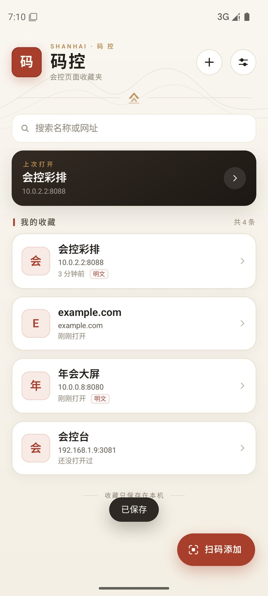
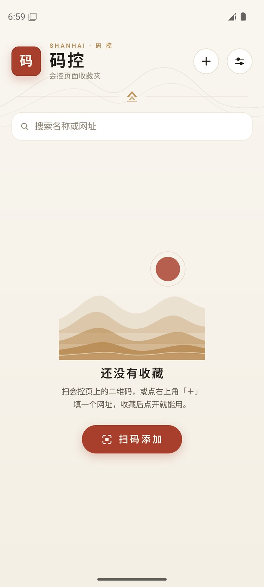
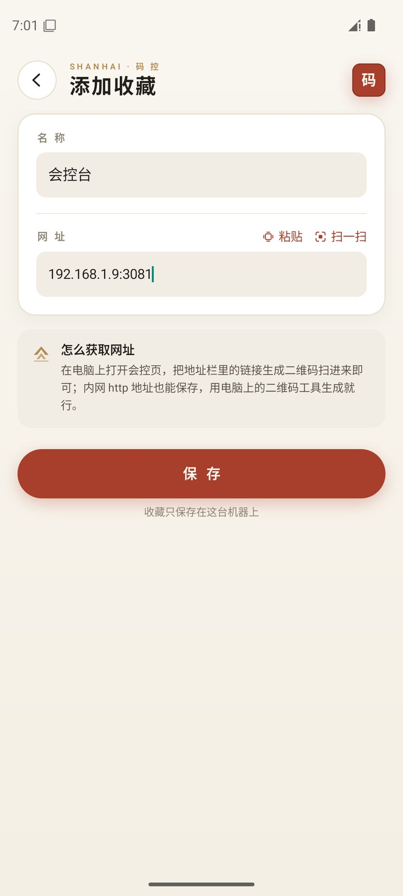
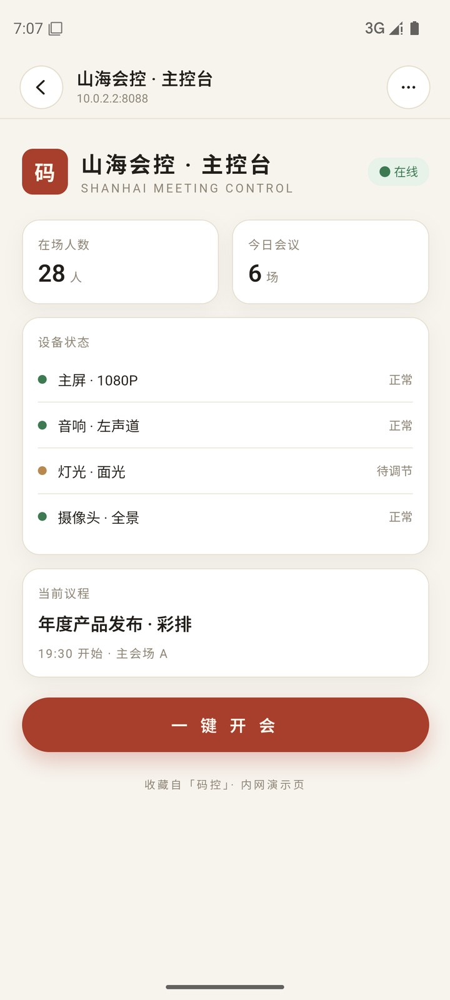
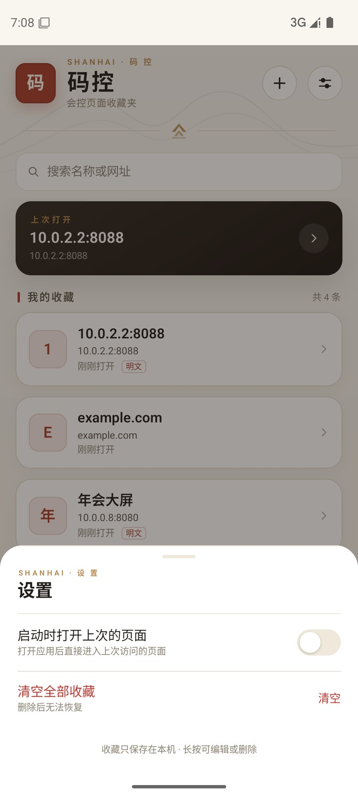
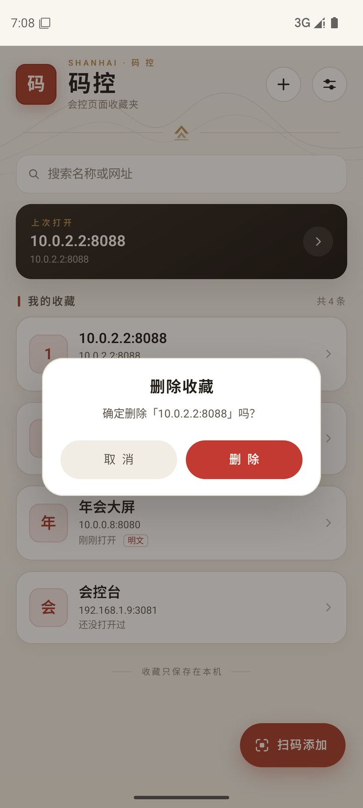
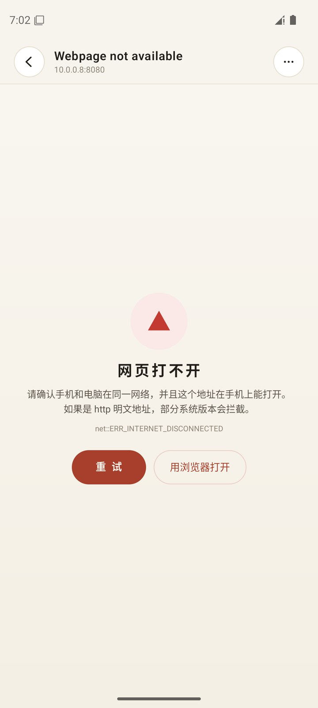
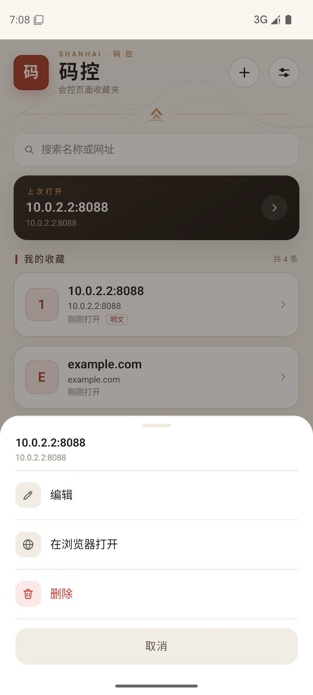
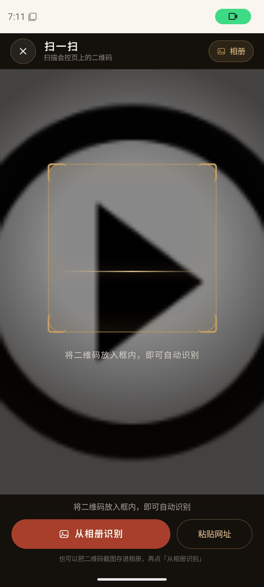

# 码控 · makong-mobile

「码控」的移动端（Android）实现：扫一扫会控页上的二维码，把地址存成本地收藏，点开直接用内嵌 WebView 打开。

- 技术栈：[Native Shell（nsh）](https://nsh.dev) 0.7.0 + TSX，界面由 Android 原生 View 与 `StaticLayout` 文字渲染，无后端、无 npm 依赖。
- 应用包名：`com.shanhai.makong`，版本 `1.0.0（1）`。
- 最低系统：Android 8.0（API 26），`targetSdk 35`。
- 与鸿蒙版共用同一套山海设计语言与数据结构，功能对齐见下表。

## 界面设计

沿用「山海系列」的新中式语言：**宣纸暖白 × 墨色 × 朱砂，鎏金作点缀**。

| 元素 | 处理 |
| --- | --- |
| 底色 | 宣纸渐变 `#F9F6F0 → #F4EFE4`，页头压一层极淡山脊 |
| 品牌 | 朱砂圆角方印「码」+ 鎏金小字 `SHANHAI · 码控`，山纹徽记作分隔 |
| 主色 | 朱砂 `#A83E2C` 只给主操作（扫码添加、保存、上次打开卡） |
| 收藏卡 | 白纸卡 + 1px 发丝边 + 18pt 大圆角 + 首字印，名称 / 域名 / 时间三阶墨色 |
| 空态 | 鎏金群山 + 朱砂日轮插画，配「还没有收藏」与两句引导 |
| 上次打开卡 | 墨色渐变卡 + 鎏金小字「上次打开」，与白纸卡形成层次 |
| 确认框 / 菜单 | 自绘纸面对话框与底部面板，替掉系统 AlertDialog |
| 图标 | 实心 / 细线 SVG，运行时 `tintColor` 染色；应用图标为玄青底 + 鎏金细边 + 居中「码」 |

三页结构：收藏列表（Home）→ 添加 / 编辑收藏（Edit）→ 内嵌网页（WebPage）。扫码是叠在任意页之上的全屏面板。

## 功能

| 能力 | 说明 |
| --- | --- |
| 扫码添加 | 相机扫码（WebView + jsQR，自动对焦外框、扫描线），也支持**从相册识别**二维码截图、**粘贴网址**；识别后自动补全 `http(s)://` 并进入添加页 |
| 手动添加 / 编辑 | 名称 + 网址两个输入框；编辑态可再次扫码覆盖网址，也可删除这条收藏 |
| 收藏列表 | 按最近打开时间倒序；卡片显示名称、域名、最近打开时间、HTTP「明文」标记；支持搜索（名称 / 地址）；长按卡片可编辑、在浏览器打开、删除 |
| 继续上次 | 首页「上次打开」横幅一键回到上次页面；设置里可开启「启动时打开上次的页面」，冷启动后自动进入 |
| 内嵌打开 | WebView 打开任意 http/https 地址，保留网页登录态；`usesCleartextTraffic` 允许内网 http |
| 网页导航 | 系统返回键优先回退网页历史，退无可退才回列表；顶栏菜单支持刷新、复制链接、在浏览器打开 |
| 加载失败兜底 | 错误页给出提示与错误信息（如 `net::ERR_INTERNET_DISCONNECTED`），可重试或改用系统浏览器打开 |
| 摄像头 / 麦克风 | 声明 `CAMERA` / `RECORD_AUDIO`，`capabilities.webview.media` 授予网页 `getUserMedia`，兼容会控页 WebRTC |
| 设置 | 启动时自动进入上次页面；清空全部收藏（纸面确认） |

## 目录结构

```
makong-mobile/
├── App.tsx                  # 入口：NavStack + 全局扫码面板 + 吐司
├── nsh.json                 # 名称 / 包名 / 图标 / 主题 / capabilities / Android 配置
├── App.test.tsx             # 冒烟测试（nsh test）
├── assets/                  # 图标、山纹、空态插画、jsQR 源码（Apache-2.0，见同目录 LICENSE）
├── scripts/gen_icon.py      # 生成 1024×1024 应用图标（Pillow）
├── dist/makong-1.0.0.apk    # 已签名的 debug APK（x86_64 / arm64-v8a / armeabi-v7a）
├── docs/screenshots/        # README 效果图
└── src/
    ├── nav.ts               # createNavStack 三页路由
    ├── store.ts             # Storage 持久化 + 收藏模型 + 排序 / 时间文案
    ├── theme.ts             # 山海配色 / 圆角 / 阴影 / 渐变
    ├── ui.tsx               # 方印、首字印、圆钮、纸卡、自绘开关等
    ├── overlays.tsx         # 底部面板、纸面确认框、吐司
    ├── toast.ts             # 轻量吐司状态
    ├── url.ts               # 网址规范化 / 校验 / 域名提取
    ├── scanner/
    │   ├── scanner.tsx      # 全屏扫码面板（相机 / 相册 / 粘贴）
    │   └── page.ts          # WebView 内的扫码页：jsQR + getUserMedia + 图片解码
    └── screens/
        ├── Home.tsx         # 收藏列表
        ├── Edit.tsx         # 添加 / 编辑
        └── WebPage.tsx      # 内嵌网页
```

## 数据与存储

与鸿蒙版一致，收藏存在 app Storage（`files/nsh/com.shanhai.makong/storage.json`）：

```
SessionItem {
  id: string          // 创建时生成
  name: string        // 列表显示名
  url: string         // 完整网址
  createdAt: number
  updatedAt: number
  lastOpenAt: number  // 最近打开时间，用于排序和「继续上次」
}
```

另外存 `last_session_id`（上次打开的收藏）与 `auto_resume`（是否启动时自动进入）。数据只在本机，卸载应用即丢失。

## 运行

前置：Android SDK（`platforms;android-35`、`build-tools`、`platform-tools`）与 JDK 17；一台设备或模拟器。

```powershell
# 安装 nsh 与 Android 运行时
irm https://nsh.dev/install.ps1 | iex
nsh component add android

$env:ANDROID_HOME = "$env:LOCALAPPDATA\Android\Sdk"
$env:ANDROID_SDK_ROOT = $env:ANDROID_HOME

# 开发运行（安装开发宿主，热更新）
nsh run makong-mobile --target android

# 打包 APK（含模拟器需要的 x86_64）
nsh package makong-mobile --target android --abi arm64-v8a,armeabi-v7a,x86_64 -o makong-mobile\dist

# 安装并启动
adb install -r makong-mobile\dist\makong-1.0.0.apk
adb shell am start -n com.shanhai.makong/com.longbridge.nsh.AppActivity
```

默认使用 debug 签名（`nsh package` 首次会生成 `~/.android/debug.keystore`）。上架或分发时传 `--keystore` / `--key-alias` / `--keystore-password` 使用正式签名。

## 权限与 capabilities

| 配置 | 用途 |
| --- | --- |
| `android.permissions: CAMERA / RECORD_AUDIO` | 网页 `getUserMedia`、会控页 WebRTC；首次使用系统弹窗询问 |
| `capabilities.webview.hosts: ["*"]` | 内嵌网页可打开任意用户收藏的地址（含内网 IP） |
| `capabilities.webview.media: ["camera", "microphone"]` | NSH 要求显式声明后才允许网页采集摄像头 / 麦克风 |
| `capabilities.picker / clipboard / openUrl / network` | 相册识别、粘贴网址、复制链接 / 外部浏览器、任意网络访问 |
| `android.usesCleartextTraffic: true` | 允许 `http://192.168.x.x:端口` 这类内网明文地址 |

扫码页用 `baseUrl="https://makong.local/"` 给内联 HTML 一个安全上下文（`getUserMedia` 要求 `https` 或 `localhost`），因此需要 `webview.hosts` 放行该主机。

## 扫码实现说明

- **相机扫码**：全屏 `Dialog` 内嵌 `WebView`，页面用 `getUserMedia` 取后置摄像头，`requestAnimationFrame` 抽帧交给 [jsQR](https://github.com/cozmo/jsQR) 解码；识别到 URL 后通过 `window.nsh.postMessage` 回传，面板关闭并进入添加页。
- **相册识别**：`Picker.pickImages()` 选图 → `arrayBuffer()` → Base64 → 注入 WebView 的 ``，同样用 jsQR 在 Canvas 上解码，不依赖相机。
- **粘贴网址**：`Clipboard.readText()`，校验后直接填入。
- 模拟器的摄像头是虚拟场景（对着 Android 玩偶），无法扫真实二维码，因此模拟器上请用「从相册识别」（已实测可识别 `http://192.168.1.9:3081/`）；真机上相机扫码可用。

## 验证情况

- 已在 Windows 上通过 `nsh check` 类型检查。
- 已在 Android 15（API 35，1080×2400，420dpi）模拟器上：
  - `nsh run --target android` 热更新运行；
  - 打包 `makong-1.0.0.apk`（arm64-v8a / armeabi-v7a / x86_64）并用 `adb install` 安装启动；
  - 空态、添加 / 编辑 / 保存、列表、搜索、上次打开、设置、纸面确认框、长按菜单、内嵌网页（含内网明文 http 演示页）、错误兜底、扫码面板（相机预览 + 相册识别）均已截图验证。
- 相册识别实测：把二维码截图放进相册，识别出 `http://192.168.1.9:3081/` 并自动填好名称与网址。
- 仍待真机确认：相机实时扫码的实际对焦 / 识别速度，以及会控页 WebRTC 在 Android WebView 中的表现。

## 效果图

Android，1080×2400（已裁成 720 宽）：

<table>
  <tr>
    <td align="center" width="50%">
      <br />
      <sub>收藏列表：上次打开卡 + 收藏卡 + 收尾说明</sub>
    </td>
    <td align="center" width="50%">
      <br />
      <sub>空态：鎏金群山 + 朱砂日轮</sub>
    </td>
  </tr>
  <tr>
    <td align="center">
      <br />
      <sub>添加 / 编辑收藏：白卡表单 + 扫码 / 粘贴</sub>
    </td>
    <td align="center">
      <br />
      <sub>内嵌网页：内网 http 会控页（演示页）</sub>
    </td>
  </tr>
  <tr>
    <td align="center">
      <br />
      <sub>设置面板：启动时打开上次的页面</sub>
    </td>
    <td align="center">
      <br />
      <sub>纸面确认框：替掉系统 AlertDialog</sub>
    </td>
  </tr>
  <tr>
    <td align="center">
      <br />
      <sub>加载失败兜底：重试 / 用浏览器打开</sub>
    </td>
    <td align="center">
      <br />
      <sub>长按收藏：编辑 / 在浏览器打开 / 删除</sub>
    </td>
  </tr>
  <tr>
    <td align="center" colspan="2">
      <br />
      <sub>扫一扫：相机预览 + 相册识别 / 粘贴网址</sub>
    </td>
  </tr>
</table>

## 图标

`assets/icon.png` 为 1024×1024 图标，由 `scripts/gen_icon.py` 生成（玄青渐变底 + 鎏金细边 + Noto Serif SC「码」）。改配色后重新执行：

```powershell
python scripts/gen_icon.py
```

## 说明

- `dist/makong-1.0.0.apk` 为 debug 签名、三 ABI 的安装包，约 148 MB：nsh 在本机没有 NDK 时使用预编译运行时（含全部原生特性）。只面向真机时可用 `--abi arm64-v8a` 显著减小体积；装好 NDK 后 `nsh` 会按需裁剪原生特性。
- 构建产物、`nsh` 生成的 `.nsh/`、截图源文件 `.shots/` 均已在 `.gitignore` 中排除。

## 许可证

[MIT License](../LICENSE)，Copyright (c) 2026 山海紫穹。

扫码解码使用 [jsQR](https://github.com/cozmo/jsQR)（Apache-2.0），源码内联在 `assets/jsqr.json`，许可证全文见 `assets/jsqr.LICENSE.txt`。
